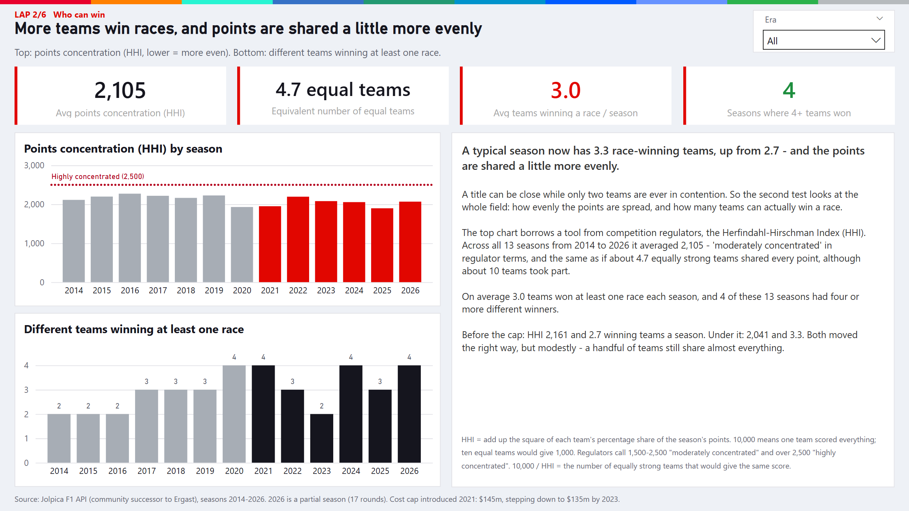

# F1 budget cap

**Did the budget cap make F1 a fair fight?**

In 2021 Formula 1 capped team spending at $145m (down to $135m by 2023). The idea was to stop the richest teams
buying championships - Mercedes had just won seven constructors' titles in a row. This project pulls 13 seasons
(2014-2026) of results, qualifying, pit stops and standings from a public API, models them in SQL and builds a Power BI
report to see whether it worked.

Short answer: partly. Title fights got closer and more teams win races, but the gap between the front and the back of
the grid hasn't really moved.



## About me

I'm Adam, an Insight and Intelligence Analyst at the London Borough of Barnet, where I look after the Power BI
reporting for the council's environment services. Before that I was a systems analyst and a data analyst in property
management, and I started out in financial services at R.J. O'Brien and UBS.

Across those roles the part of the job I've enjoyed most is the bit before the dashboard: getting data out of a new
system, working out why the numbers don't match, and shaping it into something people can rely on. At Barnet that has
meant working on the integration between a new waste management platform and Power BI, and that's what pushed me
towards data engineering.

## What I wanted to get out of this project

- Work with a real API end to end - paging, rate limits and inconsistent formats included - rather than a ready-made
  CSV.
- Keep the transformation in SQL, in layers I could rebuild from scratch at any point, instead of hiding it in Power BI.
- Treat data quality as part of the pipeline, with checks that stop a bad load from reaching the report.
- Answer a question I actually wanted to know the answer to.

## Why I'm applying to The Data School

I've learnt most of what I know on the job and by building things like this, and I've reached the point where I want
to learn data engineering properly - warehousing, transformation tools like dbt, cloud platforms and the practices
that keep a data platform reliable. The Data School offers structured training alongside real client work, with a
cohort to learn from, and that's the way I learn best. I'm also used to being the person between the technical side and
the people who use the numbers, which I think fits the consulting side of the role.

## Data

All from the [Jolpica F1 API](https://github.com/jolpica/jolpica-f1) (`api.jolpi.ca`), which replaced the old Ergast
API. No key needed. 5,479 race results, 5,458 qualifying entries, 9,870 pit stops and the final standings for every
season.

Column notes and the data problems I had to deal with are in
[`data/processed/data_dictionary.md`](data/processed/data_dictionary.md).

## How it's put together

```
Jolpica API -> scripts/ingest.py -> data/raw/*.csv
            -> scripts/build_db.py -> f1.duckdb (raw tables + views from sql/01_schema.sql)
            -> scripts/check_data.py (sql/03_checks.sql)
            -> scripts/export_processed.py -> data/processed/*.csv (star schema)
            -> Power BI
```

- **Ingest** (`scripts/ingest.py`) pages through each endpoint season by season and writes one raw CSV per entity.
- **Model** (`sql/01_schema.sql`) parses lap and pit stop times, flags each season as before or after the cap, and
  works out each team's share of the points for the concentration measure (HHI).
- **Check** (`sql/03_checks.sql`) - see below.
- **Export** (`scripts/export_processed.py`) writes the star schema that Power BI loads: four dimension tables and five
  fact tables, each with a stated grain (listed in [`powerbi/README.md`](powerbi/README.md)).
- **Analysis** (`sql/02_analysis.sql`) holds the queries behind the findings, run with `scripts/run_analysis.py`.
- **Report** (`powerbi/`) is a Power BI project (PBIP) saved as text, so the model and report pages can be read and
  diffed in git.

## Data quality and testing

`sql/03_checks.sql` holds ten checks that run after every build. Each one is a query that returns the rows breaking a
rule, so an empty result is a pass. They cover:

- one row per driver per race, and no missing keys
- every season from 2014 to 2026 loaded, and every race with a full grid (catches a page lost during ingest)
- points never negative, grid and finishing positions in a sensible range
- exactly one constructors' leader per season
- qualifying times within a believable range
- every pit stop matching a race result, and only a handful of pit stops without a time

If any check fails, `run_pipeline.py` stops before the export, so Power BI never picks up a bad load. The checks
earned their place straight away: the first run showed nine pit stops with no time, where my notes said two.

`tests/` has unit tests (pytest) for the parsing in `ingest.py` and for the SQL views, using a few hand-made rows in an
in-memory DuckDB - including a race whose results are split across two API pages, and a check that the duplicate rule
really does catch a duplicate.

## Decisions I made

- **DuckDB** - it runs locally from a single file with no server to set up, reads CSVs directly and speaks standard
  SQL, which keeps the whole build reproducible on any laptop.
- **Raw data kept as it arrives.** All cleaning happens in SQL views on top of the raw tables, so I can change a rule
  and rebuild without calling the API again.
- **2014 as the start year.** 2014 brought in the current hybrid engine rules, so it gives seven seasons before the
  cap and six after without mixing in a different era of cars.
- **Classified finishers only in `fact_results`.** Retirements have no finishing position, so they'd distort "places
  gained". They stay in the raw table.
- **Pit stops of 60 seconds or more left out of the pit crew comparison.** At that length it's a penalty or a repair,
  not a tyre change. They're still in the data.
- **Sorted exports.** Every export query has an `order by`, so re-running the pipeline gives identical files and a
  clean git diff.

## Problems I hit

- **Paging.** The API returns at most 100 rows a page, and a single race's results can be split across two pages. If
  races are simply keyed by round, the second page overwrites the first, so ingest merges them instead (there's a test
  for it).
- **Rate limits.** The API returns 429s if you go too fast, so requests back off using the `Retry-After` header.
- **Pit stops** can't be requested for a whole season, only one race at a time, and some races have none at all.
- **Inconsistent formats.** Most pit stop times are plain seconds, but a few come through as `M:SS.sss` and nine are
  blank.
- **Stand-in drivers** (André Lotterer at Spa 2014, Jenson Button at Monaco 2017) have no championship position.

## What I found

More detail in [`output/narrative_report.md`](output/narrative_report.md).

- The average title-winning margin fell from 227 to 199 points, but it swings more. Red Bull's 451-point margin in
  2023 is the most one-sided season of the lot, cap or no cap.
- McLaren went from 9th (2015 and 2017) to back-to-back constructors' champions in 2024 and 2025.
- More teams win races: 2.7 a season before the cap, 3.3 since.
- The back of the grid is as far behind as ever.

## What I'd change or add next

- **Incremental loads.** Ingest currently pulls every season each time. Only the current season changes, so it should
  just fetch new rounds and append them.
- **A proper warehouse and transformation layer.** The SQL views would move naturally into dbt models, with the checks
  as dbt tests, loading into something like Snowflake or Databricks.
- **Scheduling.** Run the pipeline automatically after each race weekend instead of by hand.
- **Sprint races.** Sprint points come from a separate endpoint and aren't included yet, so race points don't add up
  exactly to the final standings in sprint seasons.
- **Portable Power BI sources.** The report reads the CSVs from an absolute path. A parameter for the project folder
  would let it open anywhere without re-running `generate_pbip.py`.

## Running it

Python 3.11 or newer.

```
pip install -r requirements.txt
python scripts/run_pipeline.py            # build the database from data/raw, check it, export data/processed
python scripts/run_pipeline.py --ingest   # same, but pull fresh data from the API first (takes a few minutes)
pytest                                    # unit tests
python scripts/run_analysis.py            # print the analysis queries
python scripts/export_chart_previews.py   # matplotlib previews in output/chart_previews
```

The Power BI report needs Power BI Desktop on Windows - see [`powerbi/README.md`](powerbi/README.md). Screenshots of
every page are in [`output/powerbi_exports/`](output/powerbi_exports/).

## Use of AI

Where AI helped on this project is set out in [`AI_USAGE.md`](AI_USAGE.md).

## Other projects

- [Ibiza tourism economics](https://github.com/Adxmsk1/ibiza-tourism-economics) - Spain's INE statistics API, DuckDB
  and Power BI. Is Ibiza's hotel boom about more visitors or higher prices?
- [Tableau portfolio](https://github.com/Adxmsk1/tableau-portfolio) - three sport dashboards (chess, marathon running
  and ski jumping) built from data I downloaded and scraped myself.
